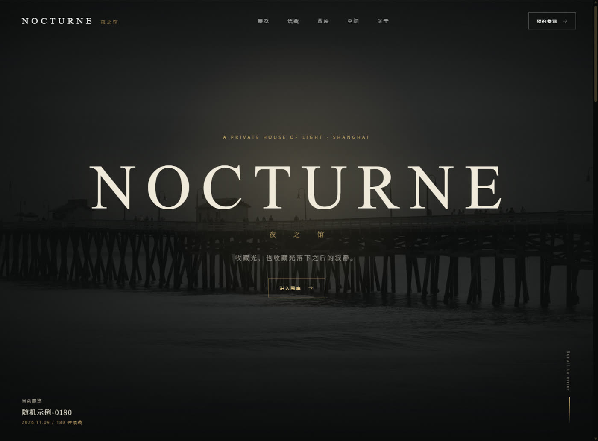
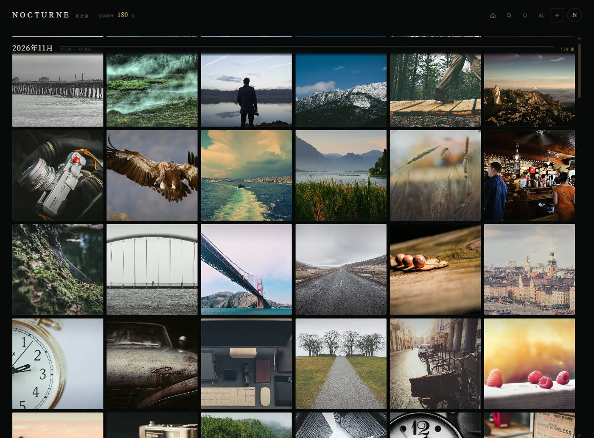
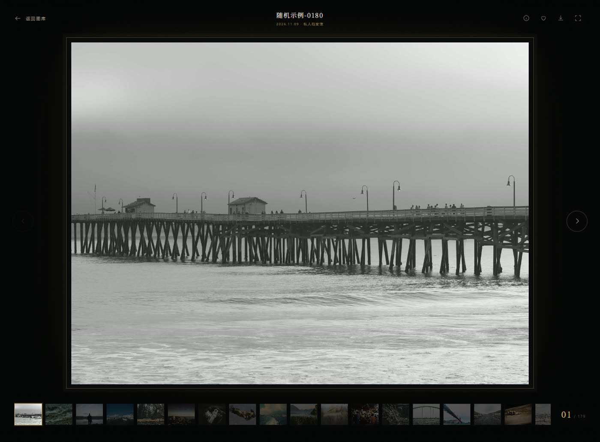
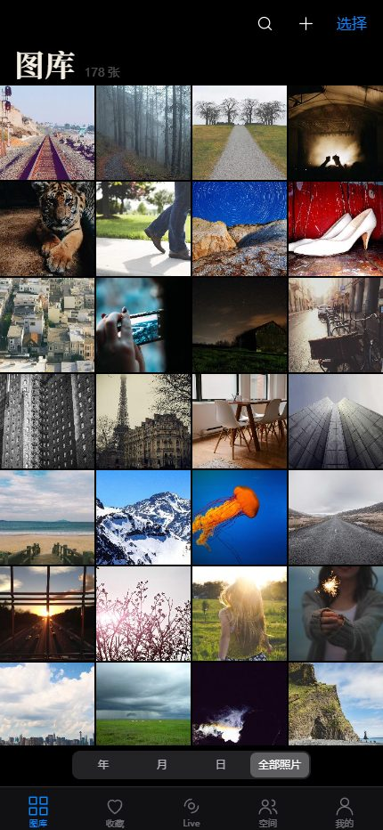
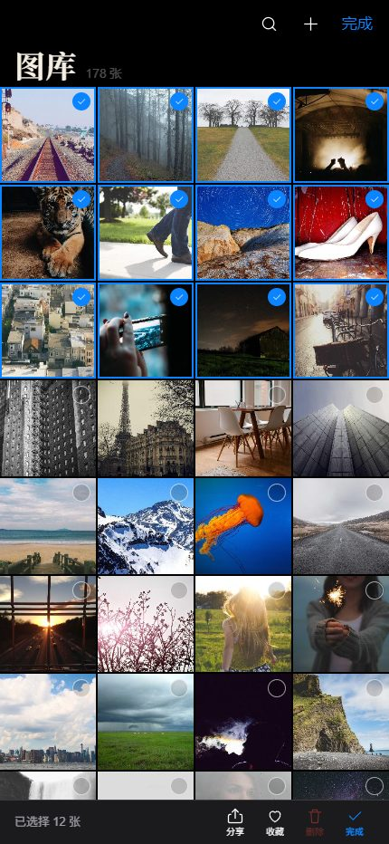
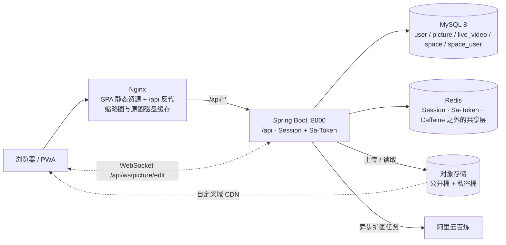

<div align="center">

# NOCTURNE · 夜之馆

**暗色私人图库 · 团队协同图片平台**

收藏光，也收藏光落下之后的寂静。

[](https://demo.raylxpj.us.ci/)


<a href="https://demo.raylxpj.us.ci/"></a>

</div>

---

## 这是什么

一个可以直接用的图片平台，前后端完整、可单机 Docker 部署：

- **暗色图库**：上传 → 自动生成预览图与多档缩略图 → 按年月分组浏览 → 搜索、分类筛选、收藏、批量整理。视觉方向是「私人档案馆」：金色细线、衬线大字、照片本身当主角，而不是常见的后台卡片墙。
- **团队空间**：空间创建 / 成员邀请 / 空间级角色（查看、编辑、管理），空间内独立图片管理与数据分析（容量、分类、标签、大小、成员贡献、活跃排行）。
- **协同与 AI**：照片可多人实时协同编辑（WebSocket + 单编辑者锁 + 操作日志），支持 AI 扩图（阿里云百炼异步任务）。
- **双端 + PWA**：桌面端保留滚轮缩放、拖拽惯性、框选；移动端是独立的 iPhone 相册式实现（双指改列数、长按拖选、左滑翻页、双击放大、下滑关闭），可添加到主屏全屏运行。

## 在线演示

**<https://demo.raylxpj.us.ci/>**

- **独立演示实例**：和作者自己在用的图册跑同一套代码，但容器、数据库、Redis、对象存储桶、域名全部独立——演示数据怎么折腾都不会碰到私人图册
- 首页 / 图库 / 查看器：**无需登录**即可浏览（预置 180 张 Picsum 示例影像）
- 上传、收藏、团队空间、协同编辑：在 [登录页](https://demo.raylxpj.us.ci/login) 注册一个账号即可试用
- 每天 04:00（北京时间）自动重置回初始数据，注册和上传的内容不会长期保留
- 跑在一台 ARM 云主机上，仅用于展示，请勿压测；这套演示实例的部署脚本见 [deploy/demo](deploy/demo/README.md)

## 界面预览

| 图库：按年月分组、搜索、分类筛选、批量选择 | 查看器：胶片条、键盘切换、缩放 |
| :---: | :---: |
|  |  |

| 移动端图库（PWA / 添加到主屏） | 移动端选择模式 |
| :---: | :---: |
|  |  |

## 功能特性

**浏览与检索**
- 首页品牌页 + 随机精选；图库按年 / 月分组，月份标题吸顶
- 关键词搜索（名称 / 地点 / 标签）、分类筛选、下滑自动加载
- 查看器：大图、胶片条、方向键切换、缩放拖拽、旋转、下载、图片信息
- 访客模式：未登录也能浏览公开图库

**上传与整理**
- 拖拽 / 多选上传，服务端自动压缩、生成长边 1280 预览图与 240 / 360 / 640 三档缩略图
- 批量选择 → 批量改分类 / 标签 / 名称规则、批量删除
- 图片元数据编辑（名称、简介、分类、标签、地点）
- Live 图片（动态照片）列表与长按播放

**团队空间**
- 创建空间（公开 / 私有）、邀请成员、分配空间角色：viewer / editor / admin
- 空间图片独立管理：上传、批量编辑、删除、协同
- 空间权限由 Sa-Token 多账号体系 + 注解 / AOP 校验，私密空间的图片落在**私密对象桶**，只能同源鉴权读取
- 空间分析：容量占用、分类分布、标签分布、大小分布、成员贡献、空间活跃排行

**协同与 AI**
- WebSocket 协同编辑：同一张照片只有一人持有编辑权，其余人实时看动作广播与日志
- AI 扩图：创建扩图任务 → 轮询任务状态 → 手动保存结果入库

**管理后台**
- 用户、图片、空间的管理列表与编辑入口（`userRole=admin` 可见）

**跨端**
- `useIsMobile()` 按「窄屏或触摸设备」分流，桌面 / 移动两套独立布局
- PWA：manifest + 手写 Service Worker + iOS 启动图，可添加到主屏全屏运行
- 移动端手势全部用 Pointer Events 实现；动效用阻尼振子采样成 CSS `linear()` 弹簧曲线（可中断、无 JS 逐帧）

## 技术栈

| 层次 | 选型 |
| --- | --- |
| 后端 | Java 11、Spring Boot 2.7.6、MyBatis-Plus 3.5.16、Sa-Token 1.39（团队空间账号体系）、Spring Session + Redis（登录态）、Caffeine 多级缓存、spring-boot-starter-websocket、Knife4j 4.4（OpenAPI 3）、Hutool |
| 存储 | MySQL 8（业务数据）、Redis（Session / Sa-Token / 缓存）、Cloudflare R2（S3 兼容对象存储，公开桶 + 私密桶；保留腾讯云 COS 实现可切换） |
| 前端 | Vue 3.5、Vite 7、TypeScript 5.9、Pinia、Vue Router；**零 UI 框架依赖**，组件与设计系统全部手写（CSS 变量 + 原生交互） |
| 外部服务 | 阿里云百炼（AI 扩图）、Cloudflare CDN / R2 自定义域（图片加速） |
| 部署 | Docker Compose（MySQL + Redis + 后端 + Nginx 前端四容器）、Nginx 磁盘缓存与 WebSocket 反代 |

## 系统架构



- 登录态走 Session Cookie（Spring Session 存 Redis）；团队空间另有一套 Sa-Token 多账号体系做空间级鉴权，两套并存互不干扰。
- 后端 context-path 固定为 `/api`，前端所有请求同源，无需处理跨域；Nginx 对 `/api/ws/` 保留 Upgrade 头。
- 图片不进数据库，数据库只存对象键；公网读图走 CDN，私密空间图片改走同源鉴权接口。

## 图片交付链路（本项目的性能重点）

一条图从上传到显示：

1. `POST /api/picture/upload` → 原图写入对象存储，带 `Cache-Control: public, max-age=31536000, immutable`
2. 同步生成长边 1280 的 `_preview.jpg`
3. 逐档生成 `_preview_w240 / w360 / w640.jpg` 三档缩略图（源图宽度不足时跳过该档）
4. 前端按「列宽 × DPR（上限 2）」吸附档位，直接拼 CDN 地址取图
5. 取不到预生成对象时，后端现场渲染并异步回填，同时写回对象存储
6. Nginx 侧再兜一层磁盘缓存（缩略图 7 天 / 原图 30 天，上限 6 GB）

实测（2026-11-06，20 张 w360 并发）：CDN 冷缓存首屏 324 ms、单张中位 246 ms；改走 CDN 主通道后首屏图片请求平均 232 ms（此前同源链路 mean 955 ms）；浏览器命中 `immutable` 缓存后 20 张 5 ms。过程中踩过的坑（错误体被当成图片缓存、`onerror` 触发整块网格重渲染、分页在滚动中途插入等）都记在 [`frontend/README.md`](frontend/README.md) 与 [`docs/图片加载链路.md`](docs/图片加载链路.md)。

## 目录结构

```text
a-picture-backend/
├─ src/main/java/com/li/apicturebackend/
│  ├─ controller/     用户、图片、缩略图、空间、空间成员、空间分析、健康检查
│  ├─ manager/        对象存储（R2 / COS）、文件与缩略图、WebSocket、AI 扩图
│  ├─ service/        业务层（MyBatis-Plus）
│  ├─ mapper/         Mapper 接口 + resources/mapper/*.xml
│  ├─ model/          entity / dto / vo / enums
│  ├─ auth/ aop/      团队空间 Sa-Token 多账号体系与权限注解切面
│  ├─ config/         缓存、跨域、Knife4j、WebSocket 注册
│  └─ common/ exception/ constant/
├─ src/main/resources/application.yml（本地）· mapper/*.xml
├─ frontend/          Vue 3 + Vite + TypeScript（移动端实现在 src/mobile）
├─ deploy/            Docker Compose、Nginx、initdb、prod 配置
└─ docs/              设计笔记 + 截图
```

## 本地开发

**环境**：JDK 11、Maven 3.8+、Node.js 18+、MySQL 8、Redis 7+（图片存储需要一份 S3 兼容桶，不配也能跑通除图片外的接口）

### 1. 准备数据库

```bash
mysql -uroot -p -e "CREATE DATABASE IF NOT EXISTS a_picture DEFAULT CHARACTER SET utf8mb4 COLLATE utf8mb4_unicode_ci;"
mysql -uroot -p a_picture < deploy/initdb/01-schema.sql
```

### 2. 启动后端

连接信息默认写在 `src/main/resources/application.yml`（`localhost:3306/a_picture` + `root/123456`、Redis `localhost:6379 db1`），按需修改，或另建 **已被 .gitignore 忽略**的 `application-local.yml` 用 `--spring.profiles.active=local` 覆盖。

```bash
mvn spring-boot:run
# 后端 http://127.0.0.1:8000/api
# 接口文档 http://127.0.0.1:8000/api/doc.html
```

### 3. 启动前端

```bash
cd frontend
npm install
npm run dev     # http://127.0.0.1:5173，Vite 已把 /api（含 WebSocket）代理到 8000
```

### 关键配置项

| 变量 / 配置 | 说明 |
| --- | --- |
| `aliYunAi.apiKey` / `ALIYUN_AI_API_KEY` | 阿里云百炼 API-KEY，仅 AI 扩图需要；留空不影响启动 |
| `r2.client.*` / `R2_*` | 对象存储连接（endpoint、AK/SK、桶名、公网域名），见 [`deploy/.env.example`](deploy/.env.example) |
| `cos.client.*` / `COS_*` | 腾讯云 COS 备用实现，`file.storage.type` 切换 |
| `SPRING_DATASOURCE_*` / `SPRING_REDIS_*` | 生产 profile 的数据库与 Redis 连接 |
| `VITE_API_TARGET` | 前端开发代理目标，默认 `http://127.0.0.1:8000` |

## Docker 部署

`deploy/` 里是完整的单机部署：MySQL、Redis、后端、Nginx 前端四个容器。

```bash
# 1. 构建产物（仓库不提交大文件）
mvn clean package -DskipTests && cp target/a-picture-backend-0.0.1-SNAPSHOT.jar deploy/app.jar
cd frontend && npm run build && cd ..
rm -rf deploy/web && cp -r frontend/dist deploy/web

# 2. 配置并启动
cd deploy
cp .env.example .env      # 填数据库口令、对象存储凭证
docker compose up -d --build   # 默认对外 8090 端口
```

前端产物是打进镜像的（没有 bind mount），改完必须 `--build`。端口、证书、数据卷、Nginx 缓存的细节见 [`deploy/README.md`](deploy/README.md)。

## 数据模型

| 表 | 作用 |
| --- | --- |
| `user` | 用户账号（账号、密码 MD5、昵称、头像、简介、角色） |
| `picture` | 图片（名称、简介、分类、标签、对象键、尺寸 / 大小 / 格式、空间 id） |
| `live_video` | Live 图片（原图与视频对象键） |
| `space` | 团队空间（名称、级别：公开 / 私有、最大数量与容量、类型） |
| `space_user` | 空间成员与空间角色（viewer / editor / admin） |

均为逻辑删除（`isDelete`），图片实际内容存在对象存储，库里只留键。

## 接口文档

启动后端后访问 **<http://127.0.0.1:8000/api/doc.html>**（Knife4j）。主要分组：

- `/user/**` 注册、登录、登出、用户管理
- `/picture/**` 上传、删除、编辑、分页查询、文件读取、缩略图、AI 扩图
- `/space/**` 空间增删改查与空间图片、`/spaceUser/**` 成员与角色
- `/space/analyze/**` 空间用量、分类、标签、大小、成员、排行
- `/health` 健康检查

## 设计笔记

写这个项目时整理的设计记录，放在 `docs/`：

| 文档 | 内容 |
| --- | --- |
| [图片加载链路](docs/图片加载链路.md) | 从上传到显示的完整链路、各链路的实测耗时与运维手段 |
| [图片协同编辑](docs/图片协同编辑-知识点.md) | WebSocket 协同、单编辑者锁、消息协议 |
| [团队空间 · 创建与成员管理](docs/团队空间-1-创建与成员管理-知识点.md) | 空间模型、邀请、角色分配 |
| [团队空间 · 权限控制](docs/团队空间-2-权限控制-知识点.md) | Sa-Token 多账号体系、注解 + AOP 鉴权 |
| [图库分析](docs/图库分析-知识点.md) | 多维统计的查询方案 |
| [批量管理](docs/批量管理-知识点.md) | 批量编辑与名称规则 |
| [AI 扩图](docs/AI扩图-知识点.md) | 异步任务提交与轮询 |
| [前端工程说明](frontend/README.md) | 组件结构、移动端手势与动效、性能优化记录 |

## 已知限制

- 收藏是浏览器本地偏好（`localStorage`），不跨设备同步。
- 分页接口的 `pageSize` 有服务端上限（防爬），一次最多拉 20 张；前端用「并发多页 + 停稳后一次性追加」换取滚动流畅度。
- AI 扩图需要自备阿里云百炼 API-KEY，且结果需手动保存入库。
- 网格仍是全量 DOM（懒加载只控制图片下载与解码）；若在更弱的机器上累积上千张后掉帧，下一步是行虚拟化。
- Live 图片功能代码完整，但演示站没有真实数据样本。
- 演示实例是单机部署，只用于展示，不做容量与并发承诺；数据每晚重置，别当网盘用。

## 说明

- 演示数据里的示例影像来自 [Picsum Photos](https://picsum.photos/)，仅作占位；换成自己的图只需在后台删除后重新上传。
- 仓库不包含任何生产口令、密钥或证书：`deploy/.env` 与 `database` 种子口令均为占位值，部署前请自行替换。
- 本项目是个人工程实践作品，欢迎 issue 交流；引用代码请注明出处。

<div align="center"><sub>NOCTURNE · 夜之馆 — 收藏光，也收藏光落下之后的寂静。</sub></div>
